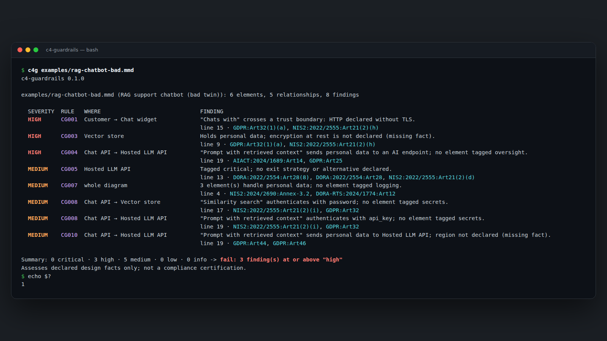
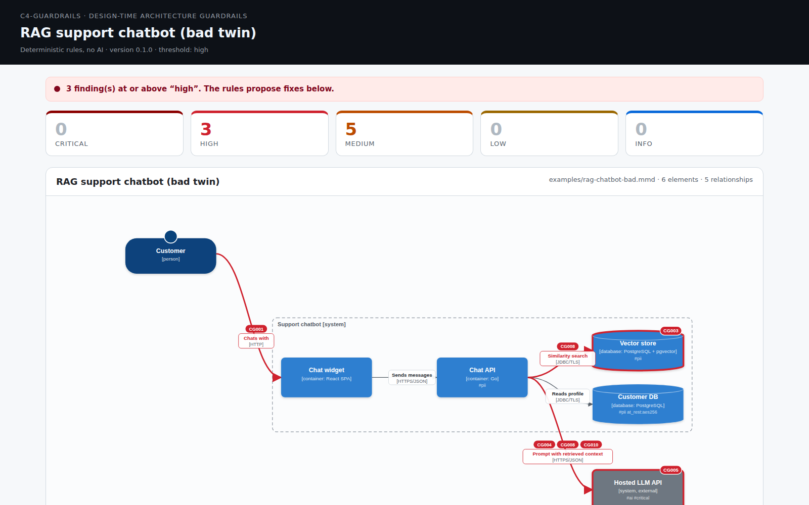
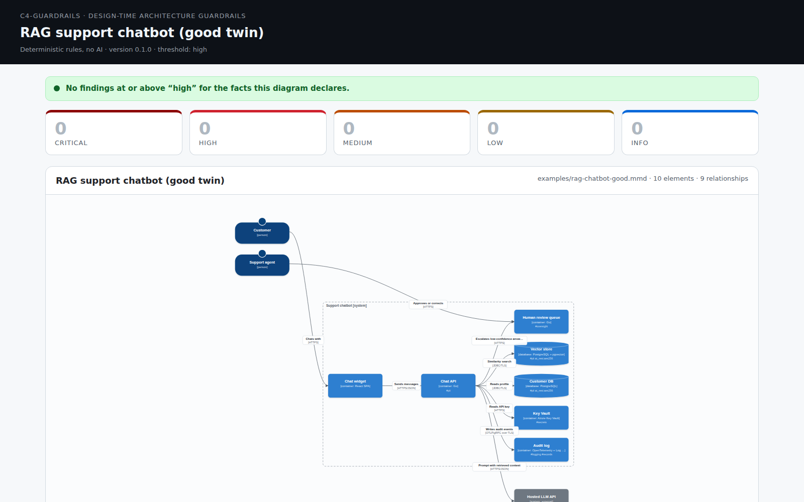
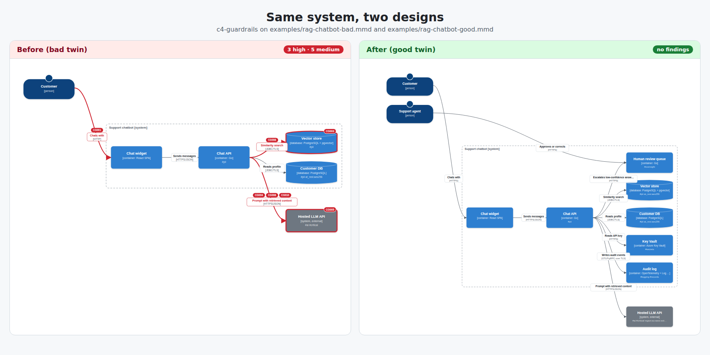
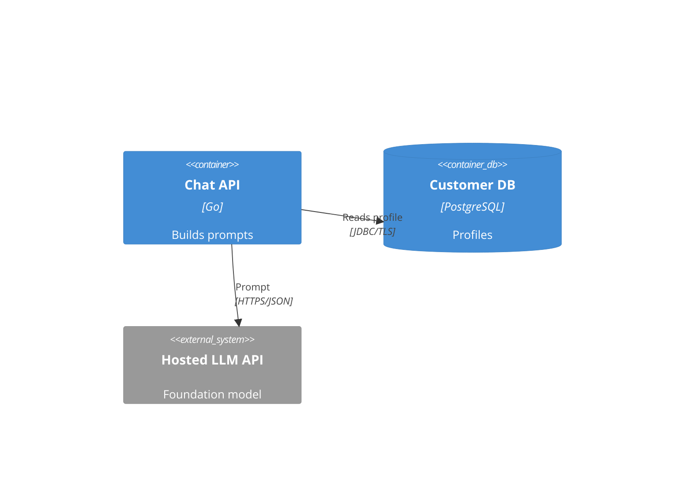
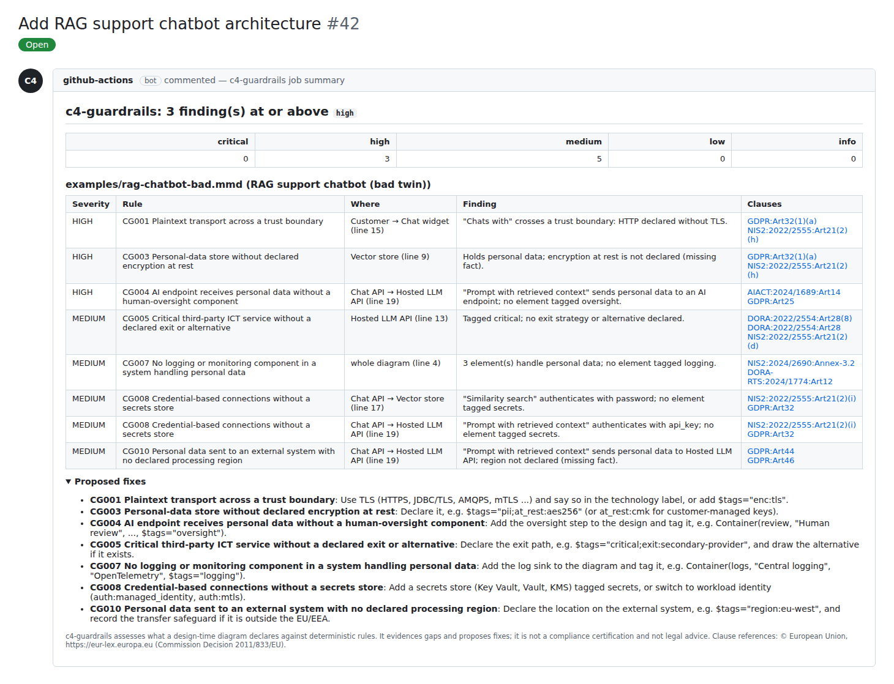

# c4-guardrails

**Deterministic architecture guardrails for C4 diagrams — with EU regulatory clause citations. Runs locally and in CI, no account, no AI.**

You write a Mermaid C4 diagram. `c4g` reads it, runs eleven plain Go rules, and tells you where the
design has gaps (plaintext across a boundary, an LLM receiving personal data with no human oversight,
a critical third-party service with no exit), each with the EU clause it relates to.



## 20-second quickstart

```sh
go install github.com/rbrus/c4-guardrails/cmd/c4g@latest
git clone https://github.com/rbrus/c4-guardrails && cd c4-guardrails
c4g examples/rag-chatbot-bad.mmd
```

Then try the fixed version, and write a report:

```sh
c4g examples/rag-chatbot-good.mmd                 # exit 0
c4g examples/rag-chatbot-bad.mmd -html report.html -sarif out.sarif -md summary.md
```

| HTML report, bad twin | HTML report, good twin |
|---|---|
|  |  |



## What it is

- A small CLI (`c4g`) and a GitHub Action that check **design-time** C4 models.
- **Findings come only from deterministic rules** (`internal/rules/rules.go`). Same input, same output, every time.
- **Every regulatory reference is a real clause id** in the form `REGIME:DOC:REF` (for example
  `GDPR:Art32(1)(a)`, `DORA:2022/2554:Art28(8)`, `AIACT:2024/1689:Art14`), taken from a trimmed list in
  [`internal/clauses/clauses.json`](internal/clauses/clauses.json). When a rule has no fitting clause, the
  output says **"no clause found"**. A test fails if a rule cites an id that is not in that list.
- Go standard library only. No network access, no telemetry, no LLM.

## What it is not

- **Not a compliance certification** and not legal advice. It assesses what the diagram *declares*; it
  cannot see what is actually deployed. Whether a regulation applies to you (DORA only covers financial
  entities, AI Act Art. 12/14 target high-risk AI systems, and so on) is for you to decide.
- Not a runtime scanner, not a pentest tool, not an IaC generator.
- A tiny slice of a larger tool. Eleven rules is a demonstration, not coverage.

## Inputs

**Mermaid C4** (`.mmd`, or the first ```` ```mermaid ```` C4 block in a `.md` file): `C4Context`, `C4Container`,
`C4Component`, `C4Dynamic`, `C4Deployment` with `Person`, `System`, `SystemDb`, `Container`, `ContainerDb`,
`ContainerQueue`, `Component` (and their `_Ext` variants), `Rel`/`BiRel`/`Rel_*`, and `Boundary`,
`Enterprise_Boundary`, `System_Boundary`, `Container_Boundary`, `Deployment_Node` blocks.

Facts are declared in the technology label and in `$tags`:



`#tag` and `#key:value` words in a description work too.

**JSON model** (`.json`, see [`examples/credit-scoring.c4.json`](examples/credit-scoring.c4.json)):

```json
{ "title": "...",
  "boundaries": [{ "id": "b", "name": "Lender", "type": "system", "tags": ["internet"] }],
  "nodes": [{ "id": "db", "type": "database", "name": "Applications DB", "boundary": "b",
              "tags": ["pii"], "attrs": { "at_rest": "aes256" } }],
  "edges": [{ "from": "app", "to": "db", "label": "reads", "protocol": "JDBC/TLS",
              "auth": "managed_identity", "encryption": "tls" }] }
```

### Vocabulary

| Tag | Meaning | Also accepted |
|---|---|---|
| `pii` | handles personal data | `personal-data`, `personal_data`, attr `data:personal` |
| `ai` | AI / LLM component | `llm`, `genai`, `ml` |
| `high-risk` | high-risk AI system | `high_risk` |
| `oversight` | human-oversight step | `human-in-the-loop`, `hitl`, `human-review` |
| `logging` | logging / monitoring sink | `monitoring`, `siem`, `observability`; inferred from e.g. OpenTelemetry, Splunk, Log Analytics |
| `records` | record-keeping log store for AI | `audit-log`, `record-keeping` |
| `secrets` | secrets store | `vault`, `kms`; inferred from e.g. Key Vault, HashiCorp Vault |
| `critical` | supports a critical or important function | |
| `internet` | internet-facing zone (on a boundary or element) | `public`, `dmz` |

| Attribute | Example | Used by |
|---|---|---|
| `auth` | `auth:oauth2`, `auth:mtls`, `auth:managed_identity`, `auth:api_key`, `auth:none` | CG002, CG008 |
| `enc` | `enc:tls`, `enc:none` (otherwise inferred: HTTPS, TLS, mTLS vs HTTP, JDBC, SQL ...) | CG001, CG011 |
| `at_rest` | `at_rest:aes256`, `at_rest:cmk`, `at_rest:none` | CG003 |
| `region` | `region:eu-west` | CG010 |
| `exit` | `exit:secondary-provider` | CG005 |

Unknown attribute keys are reported as an info-level "missing fact", never as an error.

## Rules

| Id | Severity | Rule | Clauses |
|---|---|---|---|
| CG001 | high | Plaintext transport across a trust boundary | GDPR:Art32(1)(a), NIS2:2022/2555:Art21(2)(h) |
| CG002 | high | External system called without declared authentication | NIS2:2022/2555:Art21(2)(j), GDPR:Art32 |
| CG003 | high | Personal-data store without declared encryption at rest | GDPR:Art32(1)(a), NIS2:2022/2555:Art21(2)(h) |
| CG004 | high | AI endpoint receives personal data without a human-oversight component | AIACT:2024/1689:Art14, GDPR:Art25 |
| CG005 | medium | Critical third-party ICT service without a declared exit or alternative | DORA:2022/2554:Art28(8), DORA:2022/2554:Art28, NIS2:2022/2555:Art21(2)(d) |
| CG006 | high | Database reachable directly from a person or the internet | NIS2:2024/2690:Annex-6.8, GDPR:Art25 |
| CG007 | medium | No logging or monitoring component in a system handling personal data | NIS2:2024/2690:Annex-3.2, DORA-RTS:2024/1774:Art12 |
| CG008 | medium | Credential-based connections without a secrets store | NIS2:2022/2555:Art21(2)(i), GDPR:Art32 |
| CG009 | high | High-risk AI system without a record-keeping log store | AIACT:2024/1689:Art12, AIACT:2024/1689:Art26(6) |
| CG010 | medium | Personal data sent to an external system with no declared processing region | GDPR:Art44, GDPR:Art46 |
| CG011 | info | Missing fact (undeclared transport across a boundary, unknown attribute) | no clause found |

`c4g -rules` prints the same list with clause titles.

## Outputs and exit codes

| Flag | Output |
|---|---|
| *(default)* | table on stdout; model text is flattened to one line per record |
| `-json` | JSON on stdout (findings, summary, cited clauses) |
| `-sarif FILE` | SARIF 2.1.0; clause ids in each rule's `help` and `properties.tags`; levels: high/critical → error, medium → warning, low/info → note |
| `-md FILE` | Markdown for a PR comment or `$GITHUB_STEP_SUMMARY`; all model text is escaped |
| `-html FILE` | one self-contained HTML page: severity cards, findings with clause chips linking to EUR-Lex, and the diagram as inline SVG with offending elements in red |
| `-fail-on LEVEL` | `critical`, `high` (default), `medium`, `low`, `info`, `none` |

Exit code `0`: nothing at or above `-fail-on`. `1`: findings at or above it. `2`: usage, input or output error.

## GitHub Action

```yaml
permissions:
  contents: read
  security-events: write
steps:
  - uses: actions/checkout@3d3c42e5aac5ba805825da76410c181273ba90b1 # v7.0.1
    with:
      persist-credentials: false
  - id: c4g
    uses: rbrus/c4-guardrails@<commit-sha> # pin to a full commit SHA
    with:
      files: "docs/**/*.mmd **/*.c4.json"
      fail-on: high
  - if: always() && steps.c4g.outputs.sarif != ''
    uses: github/codeql-action/upload-sarif@2892aa5e19bbd11bc0cff5427e3b750a04d9e3c2 # v4.38.2
    with:
      sarif_file: c4-guardrails.sarif
```

The action builds `c4g` from source with `actions/setup-go` (pinned by SHA), passes inputs through
environment variables only, skips symlinks, wraps the run in `::stop-commands::` so diagram text cannot
issue workflow commands, and appends the Markdown summary to the job summary.



*(Rendered locally in a GitHub-like style from the real `-md` output.)*

Short clips: [docs/media/short-1-vertical.webm](docs/media/short-1-vertical.webm) ·
[docs/media/short-2-vertical.webm](docs/media/short-2-vertical.webm). All media is regenerated from the
examples by [`tools/media`](tools/media/README.md).

## Development

```sh
go vet ./... && gofmt -l . && go test ./...
go test ./cmd/c4g -update   # refresh golden outputs after an intended change
```

See [CONTRIBUTING.md](CONTRIBUTING.md) (DCO sign-off) and [SECURITY.md](SECURITY.md).

## About

I'm Radoslaw B. This PoC is a small, open slice of ideas from Sixi Assure, a design-time architecture &
compliance assurance tool I'm building. Launching soon.

## Licence

Apache-2.0, see [LICENSE](LICENSE) and [NOTICE](NOTICE). Clause titles and links:
© European Union, https://eur-lex.europa.eu (Commission Decision 2011/833/EU). The clause summaries are
paraphrases, not legal text. Only the Official Journal of the European Union is authentic.
